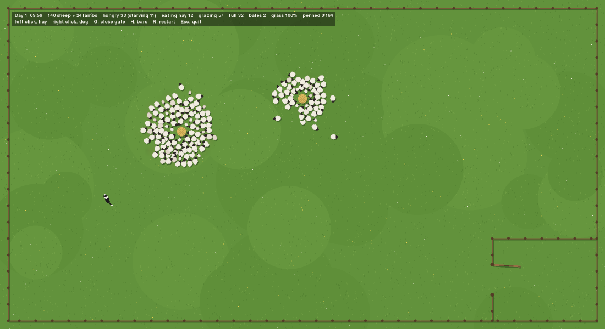

# Sheeps

A top-down sheep herding simulation in Python and pygame. A flock of sheep and lambs grazes a fenced pasture, eats hay, gathers at night and runs from the sheepdog. Your goal is to get the whole herd into the pen.



## Running

Needs Python 3.14 and [pygame-ce](https://pyga.me/).

```bash
python3 -m venv .venv
.venv/bin/pip install -r requirements.txt
.venv/bin/python sheep.py
```

## Controls

| Input       | Action                                   |
|-------------|------------------------------------------|
| Left click  | Place a hay bale, or remove one          |
| Right click | Let the dog in or move it; click the dog to remove it |
| G           | Open or close the pen gate               |
| H           | Show or hide hunger bars                 |
| R           | Restart                                  |
| Esc         | Quit                                     |
